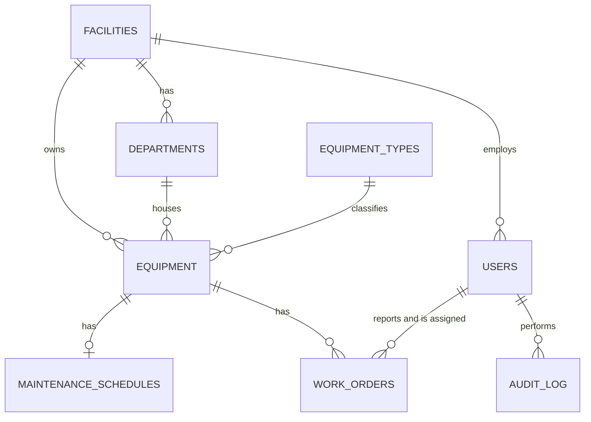

# Biomed EMS: Biomedical Equipment Management System

A multi-facility web application for tracking medical equipment, scheduling preventive maintenance, managing repair jobs, and giving county health officials the numbers they need for audits and replacement budgets.

**Live demo:** _add your link here_ (free hosting sleeps when idle, so the first load can take up to a minute)
**Demo accounts:** listed on the login page. All use the password `demo1234`.

> All facilities, people, equipment, and work orders are **fictional demo data**. Replacement costs and equipment lifespans are illustrative estimates, not real prices or standards.


## Why this exists

Hospitals depend on equipment such as ventilators, monitors, and defibrillators, and that equipment needs regular maintenance, quick repairs, and eventually replacement. Records are often scattered across paper files and spreadsheets, so it is hard to know what is overdue, what keeps failing, and what to budget for. County officials overseeing many facilities have it harder still.

This project is a working prototype of a system that answers those questions.

## What it does

**For hospital staff**
- **Equipment register**: search, filter, and view every device with its full history, lifecycle bar, maintenance schedule, and repair spend.
- **Fault reporting**: any clinician can report a fault; the device's status updates automatically if it is worse than recorded.
- **Work orders**: engineers assign jobs, technicians start and complete them, recording downtime, cost, and resolution notes.
- **Preventive maintenance (PPM)**: one click opens jobs for every device that is due; completing a job moves the next due date forward.
- **Replacement warnings**: a device is flagged when repairs approach half its replacement cost, or when it passes its expected life.

**For county officials**
- **Dashboard** with KPIs and charts, comparing facilities side by side.
- **Maintenance audit report**: functional rate, PPM compliance, downtime, and repair cost per facility.
- **Replacement budget report**: devices ranked by a transparent 0-100 priority score, with estimated replacement totals.
- **Reliability report**: failures, MTBF, MTTR, and availability by equipment type.
- Reports can be printed or downloaded as CSV.

| Role | Can do |
|---|---|
| System admin | Everything, across all facilities |
| County officer | View and report on every facility in their county (read-only) |
| Facility engineer | Manage equipment, assign jobs, and generate PPM at their facility |
| Technician | Work on jobs assigned to them |
| Reporter (clinical staff) | Report faults and view their facility's equipment |

## Screenshots

| Equipment register | Device detail | Work order |
|---|---|---|
|  |  |  |

| Audit report | Replacement budget | Reliability |
|---|---|---|
|  |  |  |

## Tech stack

Python 3 · Flask · SQLite (plain SQL, no ORM) · Jinja templates · Bootstrap 5 · Chart.js · pytest · gunicorn

## Project structure

```
app/
  __init__.py     app factory, security headers, configuration
  auth.py         login, lockout, CSRF protection, role decorators
  scope.py        THE multi-facility rule: who may see which facilities' data
  equipment.py    equipment register: list, detail, add, edit
  workorders.py   fault reports, assignment, completion, PPM generation
  metrics.py      every dashboard and report number, in one place
  reports.py      audit, budget, reliability reports and CSV downloads
  templates/      pages (Bootstrap)
database/
  schema.sql      tables, constraints, and indexes
seed_db.py        builds the fictional demo database
wsgi.py           entry point for hosting
tests/            automated tests
docs/             case study, demo script, deployment guide
```

## Data model



Design choices worth noting:
- **Equipment types carry the rules.** Risk score, PPM interval, expected life, and replacement cost live on the type, so every device of that type is treated consistently.
- **The database enforces integrity.** A composite foreign key stops a device being placed in a department of a different facility, and `CHECK` constraints protect statuses, costs, and dates.
- **Nothing is deleted.** Devices are decommissioned, so their history is kept.
- **Every important action is written to an audit log**, including logins, edits, and report downloads.

## Security

- Passwords are hashed (Werkzeug), and login errors never reveal whether an email exists.
- Every form carries a CSRF token; logout is a POST request; redirects after login stay on the site.
- Role checks happen on the server for every request, not just by hiding buttons.
- Facility scoping lives in one function (`scope.py`) that every query uses. Out-of-scope records return 404, so their existence is not revealed.
- Accounts lock for 15 minutes after 5 failed logins (switched off on the public demo, whose passwords are published).
- Security headers, `no-store` caching on private pages, secure cookies in production, and CSV cells that cannot run as spreadsheet formulas.
- The app refuses to start in production with the default secret key.

## Testing

```
pytest
```

79 automated tests cover permissions and facility scoping, the full job workflow, the report calculations (including MTBF and budget maths with known answers), CSV safety, login lockout, and time display. The seed script and the production start-up were also exercised end to end.

## Run it locally

Requires Python 3.10 or newer.

```bash
git clone https://github.com/<your-username>/biomed-ems.git
cd biomed-ems
python -m venv .venv
.venv\Scripts\activate            # Windows PowerShell; on Mac/Linux: source .venv/bin/activate
pip install -r requirements-dev.txt
python seed_db.py                 # builds biomed.db with fictional demo data
flask --app app run --debug       # open http://127.0.0.1:5000
```

Log in with `admin@example.com` and `demo1234`. **Do not set `APP_ENV=production` on your own computer.** It enables secure cookies, which only work over HTTPS.

Deployment instructions are in [docs/DEPLOY.md](docs/DEPLOY.md).

## How the key numbers are defined

- **PPM compliance**: share of devices with a maintenance schedule whose next due date has not passed.
- **Past expected life**: age greater than the expected life of the device's type.
- **Replacement review**: lifetime repair spend of at least 50% of the estimated replacement cost (a rule of thumb, adjustable in one constant).
- **Priority score**: 40 x age (capped at 150% of life) + 40 x repair spend ratio (capped at 100%) + 20 x risk score / 5.
- **MTTR**: average downtime of completed repair jobs. **MTBF**: operating time divided by failures, where operating time is the hours each active device existed in the last 730 days minus repair downtime.

## Limitations

- Prototype scale: SQLite allows one writer at a time, so a busy multi-hospital deployment would move to PostgreSQL.
- Replacement costs, lifespans, and thresholds are placeholders. A real deployment needs supplier quotes and the organisation's own policy.
- MTBF is an approximation (it assumes devices were in service for the whole period).
- No file attachments, email notifications, or barcode scanning yet.
- No Content Security Policy, and no formal accessibility audit.
- The demo's shared passwords mean anyone can change demo data; it resets when the host restarts.

## Possible next steps

Admin screen for equipment types and costs, QR-code asset tags, email alerts for overdue maintenance, a PostgreSQL option, attachment uploads for service certificates, and a Content Security Policy.
